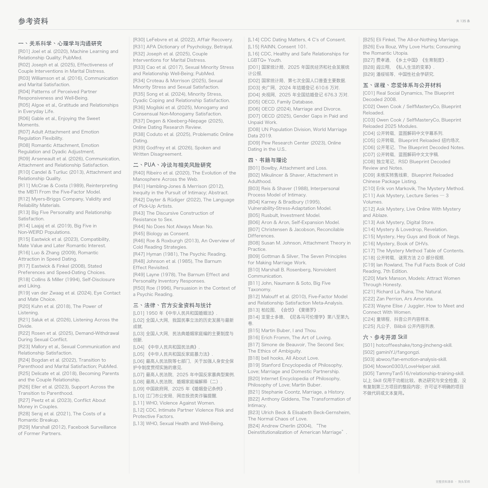

<!-- README_SYNC: source=working-tree; updated=2026-08-26 -->

<p align="center">
  <a href="https://github.com/shengjidaguai-china"><strong>Shengji Daguai オープンソースコミュニティ</strong></a>の第一弾オープン共同開発プロジェクトです ·
  <a href="https://github.com/shengjidaguai-china"><strong>Organization をフォロー</strong></a>すると、新しいプロジェクトやコミュニティ活動の情報を受け取れます
</p>

<p align="center">
  <a href="./README.md">简体中文</a> · <a href="./README_EN.md">English</a> · <strong>日本語</strong>
</p>

<h1 align="center">Goutoujunshi · AI 恋愛ストラテジスト</h1>

<p align="center">
  <strong>返信を作るだけではありません。関係を理解し、状況を読み解き、次に何をするかを決めるお手伝いをします。</strong>
</p>

<p align="center">
  惹かれ合い、デート、衝突、別れ、復縁のための AI 恋愛ストラテジストです。<br>
  感情面のサポート、関係科学、チャット分析、長期記憶を組み合わせ、複雑な状況を具体的な次の一歩に変えます。
</p>

<p align="center">
  <a href="https://github.com/powerycy/goutoujunshi/stargazers"></a>
  <a href="https://github.com/powerycy/goutoujunshi/actions/workflows/validate.yml"></a>
  <a href="./LICENSE"></a>
</p>

<p align="center">
  考えすぎる時間が少しでも減り、より明確な決断が一つでもできたなら、プロジェクトに ⭐ <strong>Star</strong> を付けてください。あとで見つけやすくなり、同じ悩みを抱える人がこのプロジェクトを見つける助けにもなります。
</p>

恋愛アドバイスの多くは「押せ」か「別れろ」の二択しかありません。Goutoujunshi は、一通のメッセージだけで結論を急ぎません。まずユーザーの感情を受け止め、そのうえで事実と推測、わからないことを切り分けます。惹かれる気持ちに加えて、現実的な事情、互恵性、リスク、機会費用、長期的な選択肢を考慮し、分析を具体的な次の一歩に落とし込みます。

これは単なる返信テンプレート集ではありません。チャットのスクリーンショット、エクスポートしたテキスト、ユーザー自身による出来事の説明を、根拠の範囲を守りながら分析できます。分析結果は、そのまま送れるメッセージ、具体的な誘い方、初デートのプラン、あとで振り返れる会話練習に変えられます。関係のライフサイクル全体を対象とした Codex Skill であり、多様な関係を前提に設計され、アドバイスの理由も説明できます。

## できること

| あなたの状況 | Goutoujunshi のサポート |
| --- | --- |
| どう返信すればいいかわからない | すぐに送れるメッセージを一つ提示し、続けてタイミングと相手の反応ごとの分岐を示します |
| 誰かにアプローチしたい、連絡を再開したい、デートに誘いたい、関係を進めたい | 具体的な行動を示し、相手の反応に応じてプランを調整します |
| 相手の気持ちが読めない、または複数の人の間で迷っている | 行動、MBTI、主観的な評価、現実的な事情を組み合わせて、明確な判断を示します |
| チャット履歴が長い、またはスクリーンショットが多すぎる | 発言者の対応付けを固定し、事実と推論、不明点を分け、既存の ChatLab データも分析できます |
| **次回また経緯を説明し直したくない** | **長期記憶:** 初回に明示的な同意を得たあと、限られたプロフィールと重要な進展をタスクをまたいで記憶します。自動で更新され、必要なものだけを呼び出し、いつでも確認、一時停止、取り消し、消去ができます |
| 遠距離、衝突、投入の不均衡、別れ、結婚の決断に向き合っている | 感情を受け止め、トレードオフを比較し、次の一歩、観察期間、やめどきの条件を示します |

## 誰を愛するべきかを決めつけません

Goutoujunshi は、異性愛、ゲイ、レズビアン、バイセクシュアル、パンセクシュアル、アセクシュアルのユーザーに対応しています。トランスジェンダー、ノンバイナリー、その他のジェンダーアイデンティティを尊重します。独身でのデート、長期的なパートナーシップ、結婚、遠距離恋愛、再婚、異文化間の関係、合意に基づくノンモノガミーについても扱えます。

このシステムは固定的な性別役割を押し付けません。どのジェンダーのユーザーも、自分から動くことや、積極的なアプローチを選ぶことができます。中国の一般的な異性間のデートの文脈では、明確な拒絶や不快感がない場合に、男性に積極性を一段階上げるよう提案することがあります。これはあくまで文化的な調整であり、個人の好みや実際の反応によって覆されます。「男性が追い、女性は待つべき」というルールではありません。判断は常に、当事者それぞれ、その行動、双方の意思、現実的な事情によって決まります。

## 学際的な恋愛ナレッジベース

このプロジェクトでは、関係科学、実践的なコミュニケーションガイド、ツール連携を分けて管理し、現在の質問に必要なものだけを読み込みます。対象とする内容は次のとおりです。

| 分野 | 内容 |
| --- | --- |
| 関係心理学 | 惹かれ合いと選択、パートナーの応答性、社会的交換、比較水準、代替選択肢、コミットメント、依存、力関係、ストレス、修復 |
| パーソナリティと感情 | MBTI、ビッグファイブ、愛着、不安、回避の責任ある使い方と限界 |
| 出会いとデート | 惹かれ合い、好意の伝え方、初デート、体験の設計、誘い方、関係をはっきりさせること、オンラインデート、ゴースティング、デジタル上の境界 |
| コミュニケーション戦略 | チャット記録の分析、状況に応じた調整、三層構造の返信設計、会話練習、傾聴、共感、褒め方、衝突、謝罪、断り方、主体性 |
| PUA と社交戦略 | Blueprint 流の内面状態、ナチュラルな流れ、コールドリーディング、Mystery 流の構造・内容・伝え方、さらにネギング、押し引きの駆け引き、コンプライアンステスト、ガスライティングのリスクとより低リスクな代替手段 |
| 性と親密さ | 継続的な同意、性に関するコミュニケーション、避妊と健康上の境界、身体の自己決定、親密さについての話し合い |
| 結婚と家族 | 婚前の取り決め、共有の家計、家事、子育て、双方の実家、家族のライフサイクル |
| 法律と安全 | 中国の婚姻家族法、DV、ストーカー行為、詐欺、証拠の保全、危機時の専門機関への紹介 |
| 社会と人文学 | 近代的な結婚の変遷、人口動態と都市化、プラットフォームを介したデート、ジェンダーによる労働の分担、ケア労働 |
| 恋愛の哲学 | 欲望、友情、自由、コミットメント、共同体、自己と他者、愛と所有 |
| 別れと特別な状況 | 失恋、裏切り、復縁、信頼の再構築、多様な関係、ステレオタイプの回避 |

ナレッジベースでは、より強い研究上の根拠と、理論的な枠組み、通説、経験に基づく手法を区別しています。MBTI、愛着スタイル、ネット上の会話テンプレートは、問いを立てたり選択肢を生み出したりするのには役立ちますが、診断、運命、必ずうまくいく方程式として示すことはありません。

## 参考文献

ナレッジベースは、関係科学、心理学とコミュニケーション研究、PUA とコールドリーディングのリスク、中国の法律と公式の安全ガイダンス、書籍、理論、公開講座の資料にわたる **135 件の参考文献**に基づいています。出典は根拠の強さと利用上の境界によって分類されています。詳しくは[主要書籍・論文の索引](./references/knowledge/19-核心书单与论文索引.md)をご覧ください。

<p align="center">
  <a href="./assets/reference-library-135.png">
    
  </a>
</p>

<p align="center"><sub>画像をクリックすると原寸大で表示されます。</sub></p>

## インストール

次のインストール用プロンプトを AI アシスタントに送信してください。

```text
Please download the public repository https://github.com/shengjidaguai-china/goutoujunshi and install it as a local Skill.
```

インストール後、次のように入力できます。

```text
Use Goutoujunshi to help me process my emotions, assess my current relationship, and decide what to do next.
```

初回の利用時には、次の項目を尋ねられます。

```text
You: MBTI / overall rating from 0–100 / main strengths and weaknesses
Person A: alias / MBTI / overall rating from 0–100 / current relationship
Person B (if any): same fields
History: how you met, how long this has developed, key events, contact, and investment
Goal: move forward, define the relationship, repair it, compare options, or leave
Emotion: what hurts most right now, intensity from 0–10, and whether a message needs an immediate reply
```

わからない項目は空欄のままでも、単に経緯を話すだけでもかまいません。Skill が話の内容からプロフィールを整理し、アドバイスを大きく変えうる情報だけを尋ねます。タスクをまたいでコンテキストを再利用したい場合は、簡潔なプロフィールをローカルに保存してよいか、別途一度だけ許可を求めます。断っても通常の利用には影響しません。

### エクスポートしたチャットファイルの分析

ChatLab は任意の依存関係です。ChatLab をインストールし、自分で取得したチャットのエクスポートを用意すれば、次のように指示できます。

```text
Use Goutoujunshi with ChatLab to analyze the last three months of chats between me and Person A.
```

Goutoujunshi はまずインポート計画をプレビューし、そのうえで会話、参加者、期間を絞ってクエリを実行します。メッセージアプリのデータベースを直接読み取ったり、復号したり、エクスポートしたりすることはありません。ChatLab がなくても、テキストを貼り付けたりスクリーンショットをアップロードしたりして分析できます。

## 一般的な回答ができるまで

```text
User's account
  → acknowledge the emotion
  → build profiles for the user and each person involved
  → separate facts / inferences / unknowns
  → retrieve only the knowledge needed for the situation
  → compare reciprocity, practical circumstances, risk, and opportunity cost
  → give a clear preferred recommendation with reasons
  → produce actions, wording, an observation window, and stopping conditions
```

長期記憶と ChatLab は、ユーザーが同意した場合や関連データを提供した場合にのみ使われます。この中核となる分析の流れは変わりません。

## プロジェクト構成

```text
goutoujunshi/
├── SKILL.md                    # Core behavior and workflow
├── agents/openai.yaml         # Codex display metadata and default prompt
├── references/
│   ├── knowledge/             # Relationship science and interdisciplinary knowledge
│   └── practical/             # Communication, tool integration, and memory rules
├── documentation/             # Architecture, workflows, and safety boundaries
└── scripts/
    ├── validate_skill.py      # Project integrity checks
    └── memory_store.py        # Consent gate, bounded memory, revocation, and deletion
```

## 設計原則

1. **問題を解く前に、人を見ます。** 感情が受け止められていなければ、正しいアドバイスでも実行できないことがあります。
2. **ラベルより行動のほうが信頼できます。** MBTI、性別、一度のチャットのやり取りを根拠に、相手の心を読めるふりはしません。
3. **相手を落とすことより互恵性が大切です。** 特定の誰かを手に入れることだけが勝利ではありません。心の消耗を減らすこと、尊厳を守ること、将来の選択肢を残すことも、正当な結果です。
4. **どの戦略にもコストを明らかにします。** Skill は、愛情や遊び心のあるメッセージ、押し引き、ペース配分、見せ方について話し合えますが、それぞれがどんな場面に合うのか、長期的にどんなコストがありうるのかも説明します。
5. **同意と離れる権利は迂回できません。** 明確な拒絶は、乗り越えるべき障害ではありません。
6. **危険な状況では安全が最優先です。** 暴力、強要、ストーカー行為、詐欺、自傷のリスクには、通常の恋愛アドバイス以上の対応が必要です。

### リリースとメンテナンスの履歴

詳しいリリースノートと互換性の情報は [CHANGELOG.md](CHANGELOG.md) をご覧ください。

| 日付 | 種類 | 更新内容 | ユーザーにとっての価値 |
| --- | --- | --- | --- |
| 2026-08-03 | 記憶とチャット分析 | これまでのプロフィール作成、感情面のサポート、関係の評価、積極的なガイド、即時の返信の機能を維持しました。初回の同意後に自動で更新され、取り消しも可能な簡潔なローカル記憶と、チャットのスクリーンショット、エクスポートした記録、既存の ChatLab データの分析を追加しました。 | おなじみのアドバイザー体験はそのままに、タスクをまたいだ範囲限定のプロフィール、確実な発言者の対応付け、関係の傾向分析ができるようになります。チャット全体を保存することはなく、メッセージアプリのデータを直接エクスポートできるとも主張しません。 |
| 2026-07-23 | アーキテクチャ | `SKILL.md` を軽量な振る舞いとルーティングの中核に縮小しました。Blueprint 流の内面状態、ナチュラルな流れ、コールドリーディング、Mystery 流の構造化されたやり取りなど、古典的な社交体系の仕組み、リスク、倫理的な置き換えを追加しました。検証の対象を必須ファイル、コンテキスト予算、実行時の境界に変更し、許可リスト方式のインストールと回帰シナリオを追加しました。 | 現在の質問に必要な 1〜3 件のリファレンスだけを読み込むため、実践的な詳細を保ちながら、日常的なコンテキストの推定コストを 48.3% 削減しました。インストールしたコピーはプロジェクトのドキュメントなしで検証でき、心を読むこと、操作、段階のエスカレーションの悪用を防ぐ安全策があります。 |
| 2026-07-22 | 調整 | 好意の伝え方、初デート、自然な接触についてのガイドを追加しました。曖昧な反応が一度あったあとに、もう一度だけ積極的に試みることを認めました。シナリオテストとチェックリストの検証を追加しました。 | 通常のデートでは適切な積極性を後押ししつつ、明確な拒絶、不快感、回避があった場合には、はっきりとした止まりどころを保ちます。 |
| 2026-07-22 | 拡張 | Tong Jincheng、Fan Gongzi、relationship-copilot Skills に関するオープンソースプロジェクトを調査しました。見せ方、状況に応じた即興、会話のやり取り、軽いフラート、リアルタイムの調整を抽出しました。7 つの主要な戦略、三層構造の返信設計、36 の返信パターン、会話練習を追加し、機能概要と中核のワークフローを更新しました。 | ペルソナや定番の手口はコピーしません。ユーザーが「どう返信すればいい？」と尋ねると、まず送信できる推奨の返信を一つ受け取り、相手の前向きな反応、曖昧な反応、拒絶の反応に応じて続けられます。 |
| 2026-07-22 | 改善 | チャットのスクリーンショット、エクスポートしたチャットのテキスト、コピーしたインスタントメッセージの内容に対応し、チャット、ユーザーの報告、通話、オフラインでのやり取り、混在した素材を区別するようにしました。 | 引き続きまず感情を整理し、そのうえで確認できる言葉と行動を分析します。テキストのチャットからオフラインでの出来事を想像したり、推論を事実として示したりはしません。 |
| 2026-07-21 | 新規 | 投入の不均衡と円満な離脱のモジュールを追加しました。出来事に基づく観察期間、投入を減らす戦略、離れるときの言葉を含み、同性・カミングアウトしていない関係、遠距離、職場、合意に基づくノンモノガミー、高リスクのシナリオにも対応します。 | 投入を続けるかどうかを判断し、自分の時間とエネルギーを守り、安全を重視したプロセスに移るべきタイミングを見極める助けになります。 |

## コントリビューション

研究の追加、コミュニケーションガイドの改善、参考文献の修正、新しい関係のシナリオの提出など、コントリビューションを歓迎します。始める前に [CONTRIBUTING.md](CONTRIBUTING.md) をお読みください。

コードを書かない方も、次のような形で参加できます。

- プロジェクトに 🌟 **Star** を付けて、より多くの人が見つけられるようにする
- 匿名化した実際のシナリオを共有して、ケースの範囲を広げる手助けをする
- いつも夜更かしして他人の恋愛を分析している友人に送る

## ライセンス

このプロジェクトは [MIT License](LICENSE) のもとでライセンスされています。著作権表示とライセンス表示を残す限り、商用利用、改変、配布が許可されています。

このプロジェクトは恋愛に関する教育と意思決定の支援を提供するものです。心理療法、医学的診断、法的助言、法執行機関、緊急サービスの代わりにはなりません。
